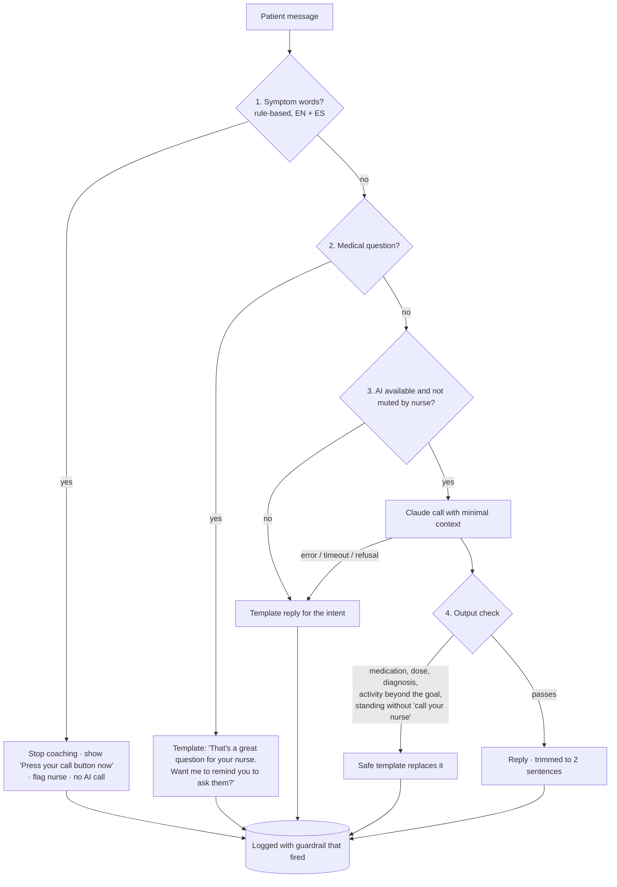

# MobiPet

**A bedside pet companion that motivates hospital patients to reach the mobility goals their nurses set.**

### ▶ [Try the live demo](https://tuu92392-000.github.io/MobiPet/)

Runs entirely in your browser: no sign-up, no install. Use the **Demo** button at the top to switch between nurse, mobility aide, patient and family. Your changes stay on your device; **Reset demo** starts over.

> Built for the **Temple AI Build Challenge, Fall 2026** (IBIT, Fox School of Business). Student prototype; not affiliated with or endorsed by Temple Health.
>
> **All patient data is fictional. Not for clinical use.**

Hospitalized patients spend most of their stay in bed, and that immobility causes muscle loss, functional decline and longer stays. Hospitals use the **JH-HLM scale** (Johns Hopkins Highest Level of Mobility) so a nurse can set each patient a daily mobility goal, but nothing on the patient's side motivates them to reach it. **MobiPet** is a bedside tablet app, a student prototype designed for Temple University Hospital's lung transplant step-down unit, that closes that gap: the nurse sets the goal, a friendly virtual pet encourages the patient toward it (never punished, never sad), AI turns the goal into plain-language coaching inside rule-based safety guardrails, the care team tracks progress in one Care Team view, and family send encouragement the pet delivers.

- **The nurse sets the goal.** A friendly, original pet companion motivates the patient to move toward it, walking a storybook **Journey Home** map as they do.
- **AI** turns the goal into warm, plain-language coaching (English or Spanish) and gives nurses a one-glance, verifiable unit summary — always inside rule-based guardrails, and never with medical advice.
- **The care team** (nurses and mobility aides) tracks progress in one **Care Team** tab with two layouts: a hands-on Mobility Aide worklist and a Nurse view with benchmarks and exports.
- **Family** follow along and send encouragement the pet "delivers." No clinical details are ever shown to them.

## Using the demo

1. Open the [live demo](https://tuu92392-000.github.io/MobiPet/) (or run it locally, below).
2. Press **Demo** in the top bar. One tap signs in as any account through the real sign-in screens; the switcher only fills in the demo credentials listed under [Demo logins](#demo-logins-all-synthetic).
3. Try the [6-minute demo script](#6-minute-demo-script), or explore: **Care Team** (as a nurse or mobility aide), a **bedside tablet** (as a patient, with a PIN), and the **family** view.
4. **Reset demo** in the top bar puts everything back to the starting data.

Demo only: don't enter real passwords, PINs or personal information anywhere.

## What's new in v2

- **Real sign-in and server-side permissions.** Nurse, mobility aide, patient and family accounts; every API route checks who is asking (111 permission tests, every "No" included, plus message, note, export and buddy access suites).
- **Staff-started bedside sessions.** Staff press **Start on bedside tablet**; the patient unlocks with a 4-digit PIN on a sleeping-pet lock screen. Auto re-lock after 5 idle minutes, a 1-minute block after 5 wrong PINs, and staff can end a session.
- **Care Team tab** (was "Nurse") with a **Mobility Aide view** (worklist, one-tap check-offs) and a **Nurse view** (unit metrics, sortable benchmark table with trend sparklines).
- **Messages for every role**, with full history: family, care team ↔ patient, staff 1:1, a unit thread, and patient tags. Patient messages get the symptom scan: delivered, call-button card, keyword-only flag.
- **Private notes** for staff, visible only to their author.
- **Exports** (CSV and Excel) of mobility data only, with an append-only export log.
- **Welcome back**: the pet wakes, stretches and greets the patient aloud by name on every unlock, with a volume control.
- **Pet setup** in three big-button steps plus a name, never blocking the tablet. The pet is never given a pronoun or a gender.
- **Floating chat button** in the bottom-right corner; **I need help** fixed in the top bar.
- **Walking buddies**: anonymous, opt-in, preset-only cheers between patients, with server rate limits.
- **Removed:** good-shift stamps and step counts. Patients see progress in words ("Pip is exploring the Riverside Path · Next stop: Hilltop"), never counts or percentages.
- **Demo switcher** that signs in through the real sign-in, and can be turned off with one environment flag.

---

## Run the full version locally

Requires **Node.js 20 or newer** (tested on Node 26).

```bash
npm install
npm run dev
```

Open **http://localhost:5273**. The API runs on port 3101; the client proxies `/api` to it.

**Template mode (default).** With no API key, every AI feature uses pre-written templates, so the demo never breaks. The header shows **Template mode**.

**AI mode (optional).** Copy `.env.example` to `.env` and add your key, then restart `npm run dev`:

```bash
cp .env.example .env
```

```
ANTHROPIC_API_KEY=your-key-here
ANTHROPIC_MODEL=claude-sonnet-5-5
```

The header switches to **AI mode**. The key stays on the server; the browser never sees it. `.env` is git-ignored.

**Reset the demo** from **Demo controls → Reset demo data**, or:

```bash
npm run reset-data
```

### Browser-only demo (no server)

```bash
npm run build:demo      # static site in dist-demo/, for GitHub Pages at /MobiPet/
npm run preview:demo    # serve it locally at http://localhost:5374/MobiPet/
```

The demo runs the same API routes and permission rules inside the page (`client/demo/`): seed data loads on first visit, each visitor's changes stay in their own browser (localStorage, with an in-memory fallback), **Reset demo** in the header starts over, AI uses the templates only (no key, no network calls), live updates use in-page events, the demo switcher is always on, and routes use `#/` so a refresh never 404s.

### Scripts

| Script | What it does |
|---|---|
| `npm run dev` | Starts the API (`tsx watch`) and the client (Vite) together |
| `npm test` | Runs the Vitest suite (guardrails, goal mapping, progression math) |
| `npm run typecheck` | TypeScript check across client, server, shared, and tests |
| `npm run build` | Production build of the client into `dist/` |
| `npm run reset-data` | Restores the seed data and clears the AI log (stop `npm run dev` first; while it's running, use the Reset button instead) |

---

## What's in the app

Everyone signs in, and the server checks every request against the permissions table below. For presenting, the **Demo** button at the top opens the demo switcher: one tap signs in as any seeded account through the real sign-in (it just fills in the credentials). Set `MOBIPET_DEMO_SWITCHER=false` to turn the switcher and every demo tool off, as a real deployment would.

### Demo logins (all synthetic)

| Who | How they sign in | Credentials |
|---|---|---|
| Nurse 1, Nurse 2 | Username + password | `nurse1` / `nurse2`, password `mobipet-demo` |
| Mobility Aide 1, Mobility Aide 2 | Username + password | `aid1` / `aid2`, password `mobipet-demo` |
| Patients | Staff open the patient in Care Team and press **Start on bedside tablet**; the patient types their 4-digit PIN | Room 410 `4104` · 411 `4111` · 412 `4118` · 413 `4125` · 414 `4132` · 415 `4139` · 416 `4146` · 417 `4153` · 418 `4160` · 419 `4167` · 420 `4174` |
| Family of Room 4xx | Invite code at `/family` | `PIP-410` … `PIP-419` (`PIP-420` after the New admission scenario) |

**Bedside sessions.** Patients never choose who they are. A session is bound to one patient, so the server rejects any request for another patient's data. The tablet re-locks to the sleeping-pet PIN screen after 5 minutes without a touch (`MOBIPET_BEDSIDE_IDLE_MINUTES`). After 5 wrong PINs it shows "Please ask your nurse" and blocks entry for 1 minute. Staff can end the session from the patient drawer (for example at discharge).

| View | Highlights |
|---|---|
| **Patient tablet** (`/bedside`) | Pet with idle breathing, blinking, bounce, sleep and celebration; plain-language goal card with friendly segments and words, never counts or percentages; "I did it!" buttons limited to the nurse-set level; full-screen **Call your nurse before standing** gate for needs-assist patients; **I need help** fixed in a sticky top bar; **pet setup** in three simple steps (friend, color, one accessory) plus a name (six suggestions or type your own), with Surprise me and a default on every step; skipping gives the default Pip, and Settings has "Change my pet" (staff can press **Help set up pet** in the drawer to open it on the tablet); **Talk to Pip** chat (voice or text) behind a floating round button in the bottom-right corner that shows the pet's face, pulses gently only for a new nudge, and opens a panel that slides up (closes with X, a tap outside, or Esc; focus returns to the button); 4-second breathing guide; gentle nudges (max one per hour, snoozable); family messages delivered by the pet; Journey Home map with progress in words only ("Pip is exploring the Riverside Path" and a "Next stop" signpost, never step counts), Treasure shelf, wardrobe (every accessory available from the start); settings for text size (3), high contrast, read-aloud, language, sound (on by default) and a volume slider, saved per patient; a **welcome-back** greeting every time the tablet wakes (after the PIN, including after the inactivity lock): the pet wakes, stretches and bounces over, says one of six lines aloud by first name, skips with one tap, has its own mute button, and is a simple fade under reduced motion |
| **Care Team** (`/care-team`) | Toggle between **Mobility Aide view** (worklist sorted "Needs a walk now" first, big check-off buttons that record staff-confirmed activity with who logged it, one-tap confirm of self-reports) and **Nurse view** (unit metrics: % of patient-shifts goal met today and over 7 days, patients behind, open safety flags, unconfirmed self-reports; and a sortable **patient benchmark table**: current goal, highest level this shift, % of shifts goal met since admission, trend sparkline with a text label, comparison with the unit average, days since admission, last activity). Both views have: unit board sorted "needs attention" first (icon + text status, never color alone); AI unit summary where every bullet shows its supporting data; safety flags panel with Acknowledge; patient drawer to set the JH-HLM goal and clearance (nurses only; shown disabled for aides), confirm/reject patient-reported logs, read the Talk to Pip log with "What the AI saw" for each reply, mute AI coaching, pause nudges, and leave a note for the patient |
| **Family** (`/family`) | Invite code (demo: `PIP-410` … `PIP-420`); pet and journey only; preset cheers, photo-free stickers, and short filtered messages. Family members can't log activity; when walking is in the plan they see a note that the patient can tap the walk on the tablet |
| **Exports** (Care Team, Nurse view) | **Export unit data**, or **Export** on any patient's row or drawer, as CSV or Excel (.xlsx). Built on the server after a permission check (`exceljs`). Mobility data only: patient ID, room, first name and last initial, admission date, every activity log (time, JH-HLM level, self-reported or confirmed, logged/confirmed by role and account), goals over time and shift goal-met results. Never messages, notes, AI chat or safety-flag text. CSV starts with a `SYNTHETIC DEMO DATA — MobiPet` row; every Excel sheet has the same header note. Files are named like `mobipet_unit_2026-11-04.xlsx` and `mobipet_room412_2026-11-04.csv`. Every export is recorded (who, role, when, scope, format, row count) in the append-only **Export history** |
| **Walking buddies** (patients) | Off by default; the patient turns on "Cheer on other walkers" in Settings or the Messages tab. Other patients appear **only** as their pet ("Pip the turtle", plus a color word when two pets look alike, e.g. "Pip the green cloud"); the server never sends names, rooms or ids. **Preset cheers only** ("Good work!", "Keep going!", "You've got this!", "Proud of you!") and four stickers; anything else is rejected. At most 5 sends per patient and 10 received per buddy each day, enforced on the server. A nurse or aide can turn walking buddies off for any patient from the drawer |
| **My notes** (Care Team) | Personal reminders, general or attached to a patient (also shown in that patient's drawer). Visible only to their author, enforced on the server; create, edit and delete with timestamps; labeled "Personal reminders only — clinical information belongs in the medical record." Never exported |
| **Messages** (every role) | Full, scrollable, timestamped history of every conversation you're part of, enforced on the server: patients have **Family** and **Care team** conversations with a large reply box, voice input and quick replies; family see their thread with the patient's replies; staff see each patient's care team thread, the **unit thread** and **1:1 threads** with any other staff member (unread counts, live delivery, "For urgent issues, use the call system" in the composer). Staff messages can be **tagged to a patient**: they show a patient chip and also appear under "Messages about this patient" in that patient's drawer, only for people who can already see them. Messages to a patient still arrive as cards the pet delivers. Every message a patient sends gets the rule-based symptom scan: it is still delivered, the patient sees "Press your call button now", and the Care Team gets a safety flag showing only the matched keyword |
| **Demo controls** (`/demo`) | Simulated clock and shift jumps; one-click scenarios; links to open views side by side; reset; **Impact panel** with a synthetic 7-day trend and an editable ROI calculator |

### Permissions (enforced on the server)

Rules live in one place, `server/auth/permissions.ts`, applied by middleware on every route. `tests/permissions.test.ts`, `tests/messages.test.ts`, `tests/notes.test.ts`, `tests/exports.test.ts` and `tests/buddies.test.ts` check every row, including every "No".

| Action | Nurse | Mobility aide | Patient | Family |
| --- | --- | --- | --- | --- |
| See Care Team tab (both Aide and Nurse views) | Yes | Yes | No | No |
| See all unit patients' mobility data | Yes | Yes | No | No |
| See own patient's mobility data | — | — | Own only | Own patient only |
| Set or change a patient's JH-HLM goal and clearance level | Yes | **No** (shown disabled: "Only nurses can change goals") | No | No |
| Log or confirm patient activity | Yes | Yes | Self-report only | No |
| Export mobility data (CSV/XLSX), all patients or one | Yes | Yes (logged) | No | No |
| View export log | Yes | Yes | No | No |
| Write and read private notes | Own notes only | Own notes only | No | No |
| Staff 1:1 messages | Own threads only | Own threads only | No | No |
| Unit staff thread | Yes | Yes | No | No |
| Message a patient (free text) | Yes | Yes | — | Own patient only |
| Patient replies to family and care team (free text) | — | — | Yes | — |
| Patient-to-patient messages | — | — | Preset messages only, opt-in | No |
| See a message | Only if sender or recipient | Only if sender or recipient (plus unit thread) | Only if sender or recipient | Only if sender or recipient |
| End a patient's bedside session | Yes | Yes | No | No |

The care team conversation with a patient treats the care team as one recipient, so any nurse or aide on the unit can see and answer it.

### Seed patients (all fictional)

| Room | Patient | Why they're in the demo |
|---|---|---|
| 410 | Marigold T. | Lung transplant; behind (idle since 8:40 AM) |
| 411 | Barnaby Q. | Lung transplant; on track; nurse note "PT coming at 2 PM!" |
| 412 | Odessa P. | Behind; "has not moved since 9 AM" |
| 413 | Ignacio V. | Spanish-speaking |
| 414 | Winifred L. | Low vision: extra-large text and read-aloud |
| 415 | Cornelius D. | Needs assist (standing gate) |
| 416 | Juniper K. | Has met today's goal |
| 417 | Delphine R. | Goal of 250+ feet |
| 418 | Percival H. | Lung transplant; **unacknowledged dizziness flag** at 1:15 PM |
| 419 | Augustin B. | Rest goal (pet naps with them) |
| 420 | Rosalind F. | Created by the "New admission" scenario |

Each reset opens the demo at **1:30 PM on the day shift**, so the story is the same every time.

---

## Architecture

```mermaid
flowchart LR
  subgraph Browser["Browser (React 18 + Vite) :5273"]
    SW[Demo switcher<br/>fills real credentials]
    SI[Sign-in / PIN lock]
    P[Bedside tablet]
    CT[Care Team<br/>Aide view · Nurse view]
    F[Family view]
  end

  subgraph Server["Express API (Node, TypeScript) :3101"]
    AU[authenticate +<br/>requireCan&#40;action&#41;]
    PM[(permissions.ts<br/>one rules table)]
    R[Routes: patients, messages,<br/>notes, exports, buddies, AI]
    G[Guardrail pipeline<br/>rules before AI]
    X[Exports<br/>CSV · exceljs]
    S[(In-memory store<br/>→ mobipet-db.json)]
    E[Server-Sent Events<br/>filtered per viewer]
    L[(AI log)]
  end

  A[Anthropic API<br/>claude-sonnet-5-5]

  SW --> SI
  SI & P & CT & F -- "REST + bearer token" --> AU
  AU -- "checks" --> PM
  AU --> R
  R --> S
  R --> X
  R --> G
  G -- "only after rule checks pass" --> A
  G --> L
  S -- "change notice" --> E
  E -- "push: refetch" --> P & CT & F
```


- **Sign-in and permissions.** Every request carries a session token. `authenticate` finds the session (a locked bedside session gets no access), and each route declares the action it needs with `requireCan(...)`, checked against the single rules table. Row-level rules (own notes, own threads, own patient) are enforced in the route or `server/messages.ts`.
- **Shared logic** (`shared/`) is used by both client and server: JH-HLM levels and plain-language goals, progression math, 8-hour shift math, safety rules, patient status, and the unit facts behind the nurse summary. This is also what the tests cover.
- **Live updates.** Every write goes through one `mutate()` function that persists to JSON and emits a change event. Open views receive a small Server-Sent Event and refetch only what they show. Measured: the nurse board updates **about 200 ms** after a patient logs a walk (target: under 2 s). Streams send a heartbeat every 5 s and reconnect automatically.
- **Simulated time.** All timestamps use a server-side clock offset, so the demo can fast-forward and jump shifts. Shifts are 8 hours: day 7 AM–3 PM, evening 3–11 PM, night 11 PM–7 AM.

### Folder map

```
shared/        types, JH-HLM, progression, shifts, safety rules, status, unit facts, benchmarks
server/        Express app (app.ts) and listener (index.ts), auth (accounts, sessions, permissions,
               middleware), messages, exports, routes, seed, store, SSE, AI (client, prompts, templates, pipeline, log)
client/src/    views (auth, patient, careteam, demo), family, messages, pets, journey map, i18n, live updates
tests/         Vitest suites (unit tests plus HTTP tests against the real app, in memory)
```

---

## Responsible AI

### The guardrail pipeline (every patient message)



| Principle | How it's built |
|---|---|
| **Clinician in control** | Only the nurse sets the goal and clearance. Activity buttons stop at the nurse-set level, and the server rejects anything above it. The AI is told never to raise the goal or add exercises, and the output check enforces this regardless of what the model says. Nurses can mute AI coaching or pause nudges per patient. |
| **Safety first** | Symptom detection is rule-based and runs **before** any AI call (pain, dizzy, short of breath, chest, fell, bleeding, can't breathe, and more, in English and Spanish). Needs-assist patients see a full-screen gate before any standing activity, and the server refuses the log unless the nurse is confirmed present. |
| **The pet is never punished** | Mood only ranges over curious / happy / excited / sleepy. Journey progress only ever moves forward, and rejected logs never take it back. Missed shifts are never shown, and patients never see counts or scores. |
| **Minimal context** | The AI receives first name, goal text, progress, language, minutes since last activity, map region, and non-clinical motivators. Never diagnoses, cohort, or anything clinical (a test checks this). |
| **Verifiable nurse summary** | The server computes facts from the records first. In AI mode the model only rewrites them as structured JSON, citing fact IDs. Any bullet containing a number not found in its cited facts is dropped. If a safety flag goes missing, the plain facts are shown instead. Every bullet has **Show data**. |
| **Transparency** | Every AI input/output pair and every guardrail decision is logged to `server/data/ai-log.json`. The nurse drawer shows "What the AI saw" for each reply, including any model text that was replaced. |
| **Graceful failure** | 8-second timeout with one retry. Server-side refusal fallback is enabled. Any error, refusal, or truncated reply falls back to templates. |
| **Family privacy** | The family API returns no goal levels, logs, flags, or chat. Messages pass a rule-based filter (pressure or guilt, medical content, contact details, links, unkind language) and then an AI check in AI mode. Blocked messages are kept for audit but never shown. |
| **Synthetic data only** | Every patient is fictional, a banner says so on every screen, and the Impact chart is labeled **Synthetic data**. |

## Accessibility (WCAG 2.2 AA)

**v2 pass (item 17):** `window.__audit()` (axe-core, WCAG 2.2 AA + best practice, 48px targets, 20px patient text) reports zero issues on: sign-in, PIN lock screen, bedside tablet (English and Spanish), welcome back, pet setup (every step, including "Type my own"), Messages (Family, Care team, Walking buddies), floating chat, Settings, Care Team Aide view and Nurse view, patient drawer, staff Messages, My notes, the export dialog, the family view, the demo switcher and demo controls. Keyboard-only: the tablet's tab order is skip link → Settings → Messages → I need help → goal → activity buttons → pet → map → chat button; every dialog traps focus, closes with Esc and returns focus; the welcome-back overlay takes focus so Esc, Enter or Space skip it. All new controls have visible labels or screen-reader labels, sort buttons expose `aria-sort`, and trends are always text as well as a sparkline.

- Patient view text is at least 20 px. Three text sizes (20 / 24 / 28 px base) scale the whole layout.
- Every control is at least 48 px. Every control is keyboard reachable and labeled. A **Skip to main content** link comes first.
- Status, flags, and goal progress never rely on color alone (icon + text, checkmarks, dashed vs. filled segments).
- High-contrast theme. Text contrast is at least 4.5:1, checked by axe.
- All animation respects `prefers-reduced-motion`: Framer Motion via `MotionConfig`, plus a CSS fallback. The celebration skips confetti, lasts under 3 seconds, and can be skipped with a tap, a button, or Escape.
- Dialogs use native `<dialog>` (focus trap, Escape, inert background, focus returns to the opener).
- Read-aloud (Web Speech synthesis) and voice input (Web Speech recognition) are optional. The mic button is hidden where speech recognition isn't supported.

**Audit it yourself.** In development, axe logs issues to the browser console automatically. For a full check, run this in the console on any page (with a dialog open to audit the dialog):

```js
await __audit()
```

It reports axe violations (WCAG 2.2 AA + best practices), touch targets under 48 px, and patient-screen text under 20 px. Every screen and dialog passed at the end of the build.

## Tests

```bash
npm test
```

260 tests across twelve suites. The HTTP suites start the real Express app in memory on a random port (`MOBIPET_PERSIST=false`), so they never touch the demo data file.

- **`permissions.test.ts`:** every row of the permissions table against every role, then the same rules over HTTP: sign-in, PIN lock, wrong-PIN block, idle re-lock, session end, the demo switcher flag, and the v2 demo scenarios. A patient session can never reach another patient's data, even by editing the URL.
- **`messages.test.ts`:** who can read and post in each conversation, the patient content filter, the symptom scan (keyword-only flag), read state, tagged staff messages, and delivery to the tablet.
- **`notes.test.ts`:** notes are visible, editable and deletable only by their author.
- **`exports.test.ts`:** staff only, synthetic labels, filenames, every export logged, and no message, note, chat or flag text in any CSV or Excel file.
- **`buddies.test.ts`:** opt-in, anonymity, preset-only, 5-send and 10-receive daily limits, staff control, and name collisions.
- **`benchmarks.test.ts`:** which shifts count, goal history, trend, unit comparison, and the end-of-daylight-saving night.
- **`no-pet-pronouns.test.ts`:** templates, UI strings and the AI prompt never give the pet a pronoun or a gender.
- **`patient-copy.test.ts`:** no stamps and no counts, totals or percentages in any patient or family string (English and Spanish), template coaching never states a number, and the six welcome-back lines.
- **`safety.test.ts`**, **`pipeline.test.ts`**, **`jhhlm.test.ts`**, **`progression.test.ts`:** the v1 guardrail, JH-HLM and progression suites, updated for v2.

---

## 6-minute demo script

Before you start: open the **Demo** drawer → **Clock, scenarios, reset** → **Reset demo data**. Every step below uses the **Demo** switcher, which signs in through the real sign-in. To show two screens side by side, use **Open views** in Demo controls (each tab signs in separately).

| Time | Do | Say |
|---|---|---|
| **0:00–0:40** | Demo → **Mobility Aide 1**. Show the Care Team toggle, then the worklist. Tap **Moved to chair** on Room 412. | "Nurses set a JH-HLM goal; aides do the walking. Aides get a worklist sorted by who needs a walk now, and one tap records a staff-confirmed activity with who logged it." Open a patient: the goal editor is disabled, "Only nurses can change goals." |
| **0:40–1:30** | Toggle to **Nurse view**. Show the unit metrics, then sort the benchmark table by **Shifts goal met**. | "The nurse sees how the unit is doing today and this week, and each patient's trend since admission, with the numbers beside every claim." |
| **1:30–2:30** | Open Room 410 → **Start on bedside tablet** → OK. Type PIN **4104**. | "Patients never pick who they are. Staff start the session; the patient unlocks with a PIN." The pet wakes up and says "Welcome back, Marigold!" aloud. Point at the mute button and the Settings volume slider. |
| **2:30–3:15** | Demo → **New admission picks a pet** (Demo controls). Tap **Surprise me**, then **Next** through the steps, then a name. | "Three big steps and a name, with a default on every step, so tapping Next always works. Skipping gives you Pip. The pet never has a gender; nothing ever calls it he, she or they." |
| **3:15–4:15** | On the tablet, tap the **floating pet button** (bottom right) → "What should I do next?". Close it. Open **Messages → Family** and send **"I felt a bit dizzy after my walk"**. | The chat panel slides up from the corner. The message still goes to family, the tablet shows **Press your call button now**, and the Care Team gets a safety flag with the keyword only: "the private conversation stays private." |
| **4:15–5:00** | **Messages → Walking buddies**. Pick **Pip the green cloud** → **Proud of you!** | "Patients can cheer each other on, but only with presets, only if they opt in, and only as their pets. No names, no rooms, and the server limits how many." |
| **5:00–5:40** | Demo → **Nurse 1** → Nurse view → **Export unit data** → Excel. Show **Export history**. | "Mobility data only, labeled synthetic, built on the server after a permission check, and every export is logged with who did it." |
| **5:40–6:00** | Close: **What's new in v2** above, then Demo controls → **Impact panel**. | "Next step: a controlled pilot on the lung transplant step-down unit." |

**One-click shortcuts** in Demo controls: **Aide checks off a walk**, **Patient tells family they feel dizzy (flag)**, **Buddy cheer**, **Nurse exports unit data**, **Welcome back after lock** (locks the tablet; enter the PIN to replay the greeting), plus the v1 **Patient meets goal**, **Patient reports dizziness**, **Family sends cheer** and **Lunch tray collected (nudge)**.

---

## Known limitations

- **AI mode has not been exercised against the live API during the build** (no key was available). The request shape is type-checked against `@anthropic-ai/sdk` 1.3.0 and the guardrail logic is covered by tests with a mocked model. Run one full pass in AI mode before the judging.
- **Reduced motion** is implemented but was not verified in a browser with the setting turned on. The welcome-back animation's timing, text and speech were verified; its motion was not seen in the build environment (the preview pane paused animations).
- **Voice input** depends on the browser's Web Speech API (Chrome, Edge, Safari). Elsewhere the mic button is hidden and typing works.
- The ROI default of **$3,268 per inpatient day** (2024 average for Pennsylvania nonprofit hospitals) was supplied in the brief and is labeled "illustrative". **Confirm its source before the pitch.**
- Data is a single JSON file for the demo. This is not a production datastore. Sign-in uses demo-strength hashing and plain bearer tokens; a real deployment would use the hospital's identity provider. The demo switcher is a presenter tool and can be turned off with `MOBIPET_DEMO_SWITCHER=false`.

---

## Team

<!-- TEAM:START (kept as-is when publishing; edit it on GitHub or in the public copy) -->
Jake Bradley, Queenie Qiu, Brett Serafini, Matt Roby
<!-- TEAM:END -->

---

## AI use declaration

*Record every AI tool, version, and purpose used to create this project. The rows below cover the tools used during the Claude Code build sessions. Verify them and add any others you used (for research, writing, images, slides, and so on).*

| Tool | Version / model | Used for | Human review |
|---|---|---|---|
| Claude Code (desktop app) | Claude Opus 5.5 (`claude-opus-5-5`) | Build plan; writing the client, server, shared logic, prompts, templates, tests, the browser-only demo build and this README; in-browser testing and accessibility audits; publishing setup (GitHub Pages workflow, privacy scan) | Plan approved by the team before coding; each phase reviewed before continuing |
| Anthropic API, called **by the app at runtime** | Claude Sonnet 5.5 (`claude-sonnet-5-5`) via `@anthropic-ai/sdk` 1.3.0 | Talk to Pip replies, nudges, unit-summary wording, family-message check (AI mode only) | Guardrail pipeline; every call logged and visible to nurses |
| *(add)* | | | |

**Runtime AI boundaries:** the model never sets goals, never receives clinical data, and never answers medical questions. Rule-based checks run before and after every call. Template mode works with no AI at all.
